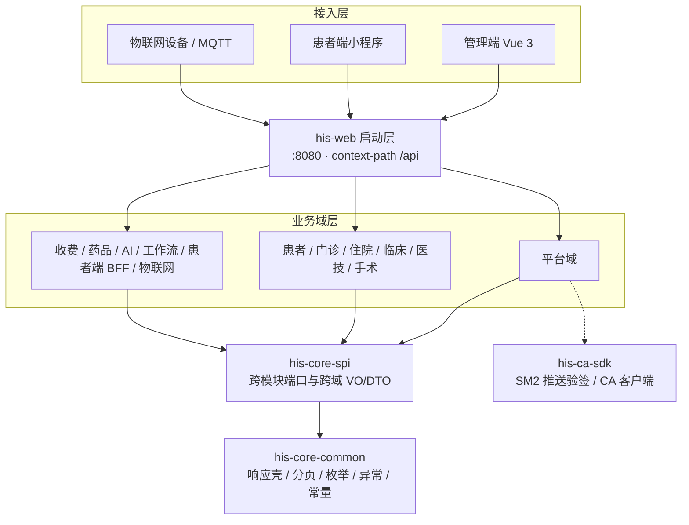

<h1 align="center">CSLK-HIS</h1>

<p align="center">面向三甲医院业务链路的全栈医院信息系统</p>

<p align="center">
  
  
  
  
  
  
  
</p>

<p align="center">
  <a href="#项目简介">简介</a> ·
  <a href="#功能模块">功能模块</a> ·
  <a href="#技术栈">技术栈</a> ·
  <a href="#系统架构">架构</a> ·
  <a href="#目录结构">目录</a> ·
  <a href="#快速开始">快速开始</a> ·
  <a href="#配置说明">配置</a> ·
  <a href="#文档">文档</a>
</p>

## 项目简介

CSLK-HIS 覆盖医院门诊、住院、急诊、手术麻醉、医技、药事、收费医保、病案质控与运营管理等业务，
并提供医疗物联网接入能力。后端是基于 Spring Boot 3 的模块化单体（17 个 Maven 模块，单进程部署），
管理端使用 Vue 3 + Element Plus，患者端为原生微信小程序。

| 维度 | 现状 |
|---|---|
| 后端 | 17 个 Maven 模块，449 个枚举，单一可部署单元 |
| 管理端 | 93 个业务视图目录，629 个 Vue 组件 |
| 患者端 | 27 个页面，4 个 tab |
| 数据库 | 24 个业务领域，366 张表；99 张表铺底数据；276 个增量脚本 |

## 功能模块

**门诊与预约**：预约挂号、现场挂号、号源池与排班模板、门诊站点与派岗、分诊叫号、
门诊病历与处方、检查检验申请、门诊收费退费与发票、复诊随访。

**住院与护理**：入院登记、床位分配与等床队列、长期/临时医嘱开立与执行、护理文书与评估、
护理排班（病区编制 → 片区审核 → 护理部备案）、转科、出院带药、ICU 监护、膳食营养、死亡登记、住院结算。

**急诊与体检**：预检分诊、急诊抢救与留观、急诊病历与收费、全院总值班与呼叫流水、
体检套餐与总检报告。

**医技与报告**：检验 LIS（申请、标本、结果、质控、危急值、室间质评）、检查 PACS（预约、登记、
影像报告、心电、病理、内镜）、血库输血与血袋追溯、透析、门诊输液、皮肤试验、医技质控、医疗废物。

**手术麻醉**：手术申请与手术间排程、术前准备与器械清点、麻醉访视与记录、PACU 复苏、
麻醉随访、日间手术评估、手术安全核查。

**药品与耗材**：药品字典、药库/药房两级库存、采购、调拨、盘点、门诊与住院发药退药、处方调剂、
静配 PIVAS、中药代煎、抗菌药物分级、麻精专册、药品追溯、耗材与消毒供应 CSSD。

**收费、医保与 DRG/DIP**：记账 → 结算 → 支付 → 票据对账四层收费、医保目录对照与结算审核报盘、
微信/支付宝/云闪付聚合支付、班结日结、欠费管控、DRG 3.0 / DIP 分组模拟与病案申诉。

**病案与质控**：病案首页编码与归档、病历质控与内涵质控、临床路径、单病种、VTE、
院感与公卫上报、不良事件、处方点评、电子签名与 CA 证书。

**平台与协同**：组织/用户/角色/岗位/菜单权限/字典/参数、操作审计、统一消息与待办、
工作台卡片、工作流（流程定义、实例、待办与流转轨迹）。

**医疗物联网**：设备台账与患者绑定、设备租赁、MQTT 遥测采集、TDengine 时序存储、
实时波形、冷链温控记录、告警事件与推送、Grafana 可视化看板。

**AI 能力**：知识库 RAG、智能问答、提示词模板、评测集与评测运行、调用日志，
21 项业务能力统一白名单与审计。

## 技术栈

### 后端

| 技术 | 版本 | 用途 |
|---|---|---|
| Java | 21 | 运行时 |
| Spring Boot | 3.2.5 | Web、事务、配置、Actuator |
| Spring Security | 随 Boot 3.2 | 认证、方法级鉴权 |
| MyBatis-Plus | 3.5.6 | ORM、分页、逻辑删除 |
| JWT (jjwt) | 0.12.5 | 登录令牌 |
| Knife4j | 4.4.0 | OpenAPI 接口文档 |
| Hutool | 5.8.26 | 通用工具 |
| BouncyCastle | 1.78.1 | SM2/SM3/SM4 国密、签名验签 |
| OpenPDF / PDFBox / POI | 1.3.30 / 2.0.31 / 5.2.5 | 单据、报告、病案导出与解析 |
| WxJava / 支付宝 SDK | 4.6.0 / 4.38.0 | 微信、支付宝支付与对账 |
| ZXing | 3.5.3 | 二维码与条码 |
| Eclipse Paho MQTT / TDengine JDBC | — | 物联网遥测接入与时序查询 |

### 数据与中间件

| 技术 | 用途 |
|---|---|
| MySQL 8 | 业务主库，按 24 个业务领域组织 |
| Redis | 会话、权限缓存、字典缓存、分布式锁 |
| RocketMQ 5.x | 操作审计落库、账单支付事件 |
| TDengine 3.x | 设备遥测与波形时序数据 |
| MQTT Broker | 设备数据上报通道（遥测 / 事件 / 波形三个主题） |
| Milvus | 知识库向量检索（RAG） |
| Prometheus / Grafana | 指标采集（Actuator + micrometer）与看板 |

### 管理端

| 技术 | 版本 | 用途 |
|---|---|---|
| Vue | 3.5.41 | 前端框架 |
| Vite | 8.2.2 | 构建与开发服务器 |
| Element Plus | 2.14.5 | 中后台组件库 |
| Tailwind CSS | 4.3.3 | 原子化样式 |
| Pinia | 4.0.3 | 全局状态 |
| Vue Router | 5.3.1 | 路由与权限守卫 |
| Vue Flow | 1.48 | 工作流流程设计器 |
| ECharts | 6.1 | 工作台与统计图表 |
| Axios / sm-crypto | 1.7 / 0.5.7 | 请求封装、前端国密辅助 |

### 患者端与部署

| 技术 | 用途 |
|---|---|
| 微信小程序（原生） | 27 个页面、4 个 tab，经 `his-ms-app` BFF 聚合 |
| Docker Compose | 后端、管理端（Nginx）一键编排 |
| Nginx | 静态资源与 `/api` 反向代理 |

## 系统架构

### 分层与依赖

单进程部署、按业务域切分模块。依赖严格单向：启动层 → 业务域 → 跨模块契约 → 公共底座，
业务域之间不互相依赖；跨域读取通过 `his-core-spi` 定义端口，由数据宿主模块实现。



### 模块划分

| 模块 | 领域 | 核心内容 |
|---|---|---|
| `his-ms-platform` | 平台域 | 组织 / 用户 / 角色 / 岗位 / 菜单权限 / 字典 / 参数 / 审计 / 消息 / 工作台 / 科室病区诊室 / 设备台账 / 电子签名与 CA 证书 |
| `his-ms-patient` | 患者域 | 患者主档 / EMPI 合并 / 标签 / 就诊人 / 医患关系 / 过敏史与既往史 / 体检 / 在线咨询 / 远程会诊 |
| `his-ms-outpatient` | 门诊域 | 预约挂号 / 号源排班 / 门诊站点 / 分诊 / 排队叫号 / 急诊 / 值班 / 班次 / 考勤 / 复诊费策略 |
| `his-ms-inpatient` | 住院域 | 入院 / 床位分配与等待 / 医嘱与执行 / 护理文书与质控 / 转科 / 出院带药 / ICU / 死亡登记 / 膳食 / 会诊 / VTE |
| `his-ms-clinical` | 临床文书域 | 病历 / 病案归档 / 病历质控 / 临床路径 / 处方 / 检查检验申请 / 慢病 / 随访 / 院感 / 公卫上报 / 处方点评 / 单病种 |
| `his-ms-medicaltech` | 医技执行域 | 检验 LIS / 影像 PACS / 报告 / 危急值 / 心电 / 病理 / 内镜 / 血库输血 / 透析 / 门诊输液 / 医技质控 / 医疗废物 |
| `his-ms-operation` | 手术麻醉域 | 手术申请 / 手术间 / 器械清点 / 麻醉访视与记录 / PACU / 麻醉随访 / 日间手术 / 安全核查 |
| `his-ms-charge` | 收费支付域 | 记账 / 结算 / 优惠 / 医保目录对照与结算 / 微信支付宝银联 / 退款 / 票据 / 班结日结 / 欠费管控 / DRG-DIP / 病案申诉 |
| `his-ms-pharmacy` | 药品耗材域 | 药品字典 / 库存 / 调拨 / 发药退药 / 调剂 / 抗菌药物 / 采购 / 耗材 / CSSD / PIVAS / 盘点 / 追溯 / 麻精专册 / 中药代煎 |
| `his-ms-iot` | 医疗物联网域 | 设备台账与绑定 / 设备租赁 / MQTT 遥测 / TDengine 时序读写 / 波形缓存 / 冷链温控 / 告警事件与推送 |
| `his-ms-ai` | AI 能力域 | 知识库 RAG / 智能问答 / 提示词模板 / 评测集 / 调用日志 / 21 项业务能力 |
| `his-ms-workflow` | 工作流域 | 流程定义（审批流 / AI 集成流）/ 实例 / 待办与流转轨迹 / 统一待办聚合 |
| `his-ms-app` | 患者端 BFF | 微信登录 / 挂号预约 / 复诊 / 缴费 / 账单 / 报告 / 体检 / 检查预约 / 发票 / 问卷 / 排队 / 押金 / 消息 / 分诊 |
| `his-web` | 启动层 | 聚合全部业务域，`com.his.HisApplication`，jar 名 `his-backend.jar` |

基础设施模块：`his-core-common`（响应壳、分页、枚举、异常、常量）、`his-core-spi`（跨模块端口与跨域 VO/DTO）、
`his-ca-sdk`（CA 对接 SDK）。

### 部署形态

开发环境直接运行 `his-web`（8080，`/api` 前缀）；生产使用 Docker Compose 启动后端容器
（宿主 8009 → 容器 8080）与管理端 Nginx 容器（宿主 3100 → 容器 80，同时代理 `/api`）。
MySQL、Redis、RocketMQ、TDengine、Milvus、MQTT Broker 独立部署，凭据统一由环境变量注入。

## 目录结构

```text
cslk/
├── source/
│   ├── back_end/                    # 17 个 Maven 模块，单一可部署单元
│   │   ├── his-core-common/         #   公共底座：响应 / 分页 / 基类 / 枚举 / 异常
│   │   ├── his-core-spi/            #   跨模块契约：端口接口与跨域 VO/DTO
│   │   ├── his-ca-sdk/              #   CA 对接 SDK
│   │   ├── his-ms-*/                #   13 个业务与能力域
│   │   └── his-web/                 #   启动层（:8080 · /api）
│   ├── front/                       # Vue 3 管理端（api / views / components / router / stores）
│   └── miniapp/                     # 微信患者端小程序
├── docs/
│   ├── 00-开发文档/                  # 需求、概要/详细设计、业务架构、工作流、物联网设计
│   ├── 01-初始化DDL/                 # 24 个领域、366 张表的建表基线
│   ├── 02-铺底基础数据/              # 99 张表的初始化数据与导入顺序
│   ├── 03-增量SQL变更/               # 276 个按编号排序的增量脚本
│   ├── 10-ER关系图/                  # 离线查看器、关系明细、分域 Mermaid
│   └── 12-部分流程图/                # 诊疗闭环、质控体系、AI 能力全景
├── docker/                          # Compose、后端/前端 Dockerfile、Nginx 配置
├── tools/                           # 辅助工具
└── AGENTS.md                        # 开发规范（分层、命名、SQL、鉴权等硬约束）
```

## 快速开始

### 环境要求

| 组件 | 版本 | 说明 |
|---|---|---|
| JDK | 21+ | 后端编译与运行 |
| Maven | 3.9+ | 多模块构建 |
| MySQL | 8.0+ | 业务库，字符集 utf8mb4 |
| Redis | 6+ | 会话、权限与字典缓存 |
| RocketMQ | 5.x | 审计与支付事件（不启动不影响主流程，审计会缺） |
| TDengine | 3.x | 物联网时序数据（不接物联网可跳过） |
| Node.js | 20.19+ / 22.12+ | 管理端构建 |
| pnpm | 8+ | 前端包管理 |
| 微信开发者工具 | 最新 | 仅患者端需要 |

### 1. 初始化数据库

准备空库（例如 `hn_biz_his`，字符集 `utf8mb4`），按顺序执行三段脚本：

```bash
# ① 建表：docs/01-初始化DDL 下 01 ~ 24 号文件，按文件名顺序
mysql -u root -p 库名 < "docs/01-初始化DDL/01-系统基础（组织·用户·岗位·权限·参数·字典）.sql"
# …… 依次执行至 24

# ② 铺底：99 张表基础数据，根目录脚本串起全部领域
cd docs/02-铺底基础数据
mysql --default-character-set=utf8mb4 -u root -p 库名 < 00_import_all.sql

# ③ 增量：按文件名顺序执行 276 个脚本
cd ../03-增量SQL变更
for f in $(ls *.sql | sort); do mysql -u root -p 库名 < "$f"; done
```

顺序不可颠倒：铺底依赖建表，增量依赖铺底的基础数据。执行完可核对表数：

```sql
SELECT COUNT(*) FROM information_schema.TABLES WHERE TABLE_SCHEMA = '库名';
```

基线为 366 张表。`docs/03-增量SQL变更/239-DRG2.0-3.0整体数据铺底.sql` 体积较大，首次导入耗时较长。

### 2. 启动后端

配置分三层：`application.yml`（公共）、`config/domain/his-*.yml`（领域行为片段）、
`application-{dev,pro}.yml`（环境差异）。数据库、Redis、JWT 等敏感项走 `HIS_*` 环境变量。

```bash
cd source/back_end
mvn clean package -DskipTests
java -jar his-web/target/his-backend.jar
# 或在 IDE 中运行 com.his.HisApplication
```

启动后：

- 业务接口：`http://localhost:8080/api`
- 接口文档：`http://localhost:8080/api/doc.html`
- 管理端点：`http://localhost:18080/actuator`（默认仅绑回环，可由 `HIS_MGMT_ADDRESS` 放开）

上传文件与证书不落源码目录，由 `his.upload.base-dir` 指定数据根目录：`uploads/` 存影像与 PDF，
`crypto/` 存医保国密证书。开发环境默认指向 `source/cslk-data`。

### 3. 启动管理端

```bash
cd source/front
pnpm install
pnpm dev        # http://localhost:3000
```

开发服务器将 `/api` 与 `/uploads` 代理到 `http://localhost:8080`。后端不在本机时：

```bash
VITE_API_TARGET=http://192.168.1.10:8080 pnpm dev
```

### 4. 患者端小程序

用微信开发者工具导入 `source/miniapp/`，修改 `source/miniapp/utils/request.js` 中的 `BASE_URL`
为可访问的后端地址，必须带 `/api` 前缀。

### 5. Docker Compose 部署

镜像只装运行时，jar 与前端产物在本机构建后拷入构建上下文：

```bash
# 构建后端
cd source/back_end
mvn clean package -DskipTests
cp his-web/target/his-backend.jar ../../docker/backend/his-backend.jar

# 构建管理端
cd ../front
pnpm install && pnpm build
rm -rf ../../docker/front/dist
cp -r dist ../../docker/front/dist

# 启动
cd ../..
cp docker/.env.example docker/.env      # 填真实值，.env 不入库
docker compose -f docker/docker-compose.yml up -d --build
```

启动后管理端为 `http://localhost:3100`，后端为 `http://localhost:8009/api`。离线环境使用
`docker/docker-compose.offline.yml`（镜像预置，不联网构建）。

## 配置说明

最少启动需要以下环境变量，完整清单见 `docker/.env.example`。

| 变量 | 用途 | 必填 |
|---|---|---|
| `HIS_DB_URL` | JDBC 连接串（含库名与时区） | 是 |
| `HIS_DB_USERNAME` / `HIS_DB_PASSWORD` | 数据库账号 | 是 |
| `HIS_REDIS_HOST` / `HIS_REDIS_PASSWORD` | Redis 地址与密码 | 是 |
| `HIS_JWT_SECRET` | 登录令牌签名密钥 | 是 |
| `HIS_SIGN_SECRET` | 业务签名与软签密钥 | 是 |
| `HIS_UPLOAD_BASE_DIR` | 运行时数据根目录 | 生产必填 |
| `HIS_ROCKETMQ_NAME_SERVER` | RocketMQ 地址 | 审计/支付事件需要 |
| `HIS_INSURANCE_MODE` / `HIS_INSURANCE_BASE_URL` | 医保联调模式与前置地址 | 医保结算需要 |
| `HIS_MILVUS_URL` / `HIS_MILVUS_TOKEN` | 向量库地址与令牌 | RAG 需要 |
| `HIS_AI_API_KEY` | 模型服务密钥 | AI 能力需要 |
| `WX_PAY_*` / `ALIPAY_*` / `UNIONPAY_*` | 支付渠道商户参数 | 对应渠道需要 |
| `HIS_IOT_MQTT_BROKER` / `HIS_IOT_TSDB_URL` 等 | 物联网 Broker 与时序库连接 | 物联网需要 |

密钥只从环境变量读取，仓库内不保存真实凭据；`docker/.env` 已在忽略列表中。

## 数据标准

| 标准 / 编码 | 系统落点 | 用途 |
|---|---|---|
| ICD-10 | `sys_icd10` | 门诊/住院诊断、病案首页、DRG/DIP 入组 |
| ICD-9-CM3 | 手术与操作字典 | 手术申请、麻醉记录、病案首页 |
| 医保目录 | 目录与对照表 | 药品/耗材/项目对照、结算与报盘 |
| DRG 3.0 / DIP | 分组器与病种目录 | 分组模拟、结算差异、病案申诉 |
| 诊疗科目名录 | `sys_med_subject` + 科室映射 | 病案首页、卫统与医保上报 |
| 国密 SM2/SM3/SM4 | `his-ca-sdk` 与签名模块 | 电子签名、CA 验签、数据加密 |

## 文档

| 文档 | 内容 |
|---|---|
| [需求与设计文档](docs/00-开发文档/) | 需求规格、用户需求、业务架构、概要设计、详细设计、角色岗位菜单模型 |
| [整体架构图](docs/00-开发文档/整体架构图.html) | 可离线打开的架构图 |
| [工作流模块设计](docs/00-开发文档/工作流模块-设计与用法.md) | 节点类型、流转规则、AI 节点接入 |
| [物联网数据存储设计](docs/00-开发文档/物联网设备数据存储设计.md) | 建点模型、时序表结构与写入策略 |
| [TDengine 部署与接入](docs/00-开发文档/物联网时序库（TDengine）部署与接入.md) | 时序库安装、库表初始化与连接配置 |
| [初始化 DDL](docs/01-初始化DDL/) | 24 个领域、366 张表建表基线 |
| [铺底基础数据](docs/02-铺底基础数据/) | 99 张表初始化数据与导入顺序 |
| [增量 SQL 变更](docs/03-增量SQL变更/) | 276 个结构演进脚本 |
| [E-R 关系图](docs/10-ER关系图/) | 离线查看器、关系明细、分域 Mermaid |
| [流程图](docs/12-部分流程图/) | 诊疗闭环全景、质控体系、AI 能力全景、急诊响应形态 |

## 常见问题

**初始化时报 `Table doesn't exist`**
执行顺序错误。先 `docs/01-初始化DDL` 建表，再 `docs/02-铺底基础数据`，最后 `docs/03-增量SQL变更`。

**写库时报 `1364 Field 'create_by' doesn't have a default value`**
基线审计列未留默认值。先执行 `docs/03-增量SQL变更/20261023_姓名与操作人NOT_NULL列剥掉DEFAULT.sql`，
使活库列形状与基线一致。

**登录成功但页面空白或接口 403**
先确认 Redis 可用；再检查当前岗位是否具备该页面按钮权限。401 为令牌失效（清登录态），
403 只提示、不清登录态。

**审计日志没有落库**
检查 RocketMQ 是否启动、`HIS_ROCKETMQ_NAME_SERVER` 是否正确。审计主题为 `HIS_AUDIT_LOG`。

**小程序请求 404**
`BASE_URL` 必须带 `/api` 前缀，并确保设备与开发者工具能访问后端网络。

**端口被占用**
后端 8080、管理端 3000、Docker 后端 8009、Docker 管理端 3100、管理端点 18080。
改端口时同步调整 `VITE_API_TARGET` 与 Nginx 配置。

## 开发规范

- **跨域只走端口**：业务域之间禁止互相 import，契约放 `his-core-spi`，实现在数据宿主模块。
- **一列一枚举**：码值统一放在 `his-core-common` 的 `enums`，字典类型编码统一由 `DictTypeConst` 提供。
- **Controller 只做转发**：接收 DTO → 调用 service → 返回统一响应；业务判断、事务与数据范围收口在 service。
- 分层、命名、SQL、鉴权、脱敏与收费/药品链路的具体约束见 [AGENTS.md](AGENTS.md)。

## 联系与许可

- **作者**：隔壁老柴（GitHub [@cslaochai](https://github.com/cslaochai)）
- **邮箱**：1043188782@qq.com
- **问题反馈**：优先提交 Issue，内部协作者可通过 Gitea 仓库联系
- **License**：私有项目，保留所有权利
