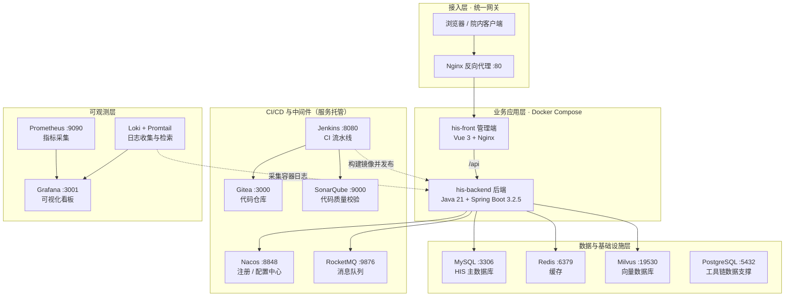
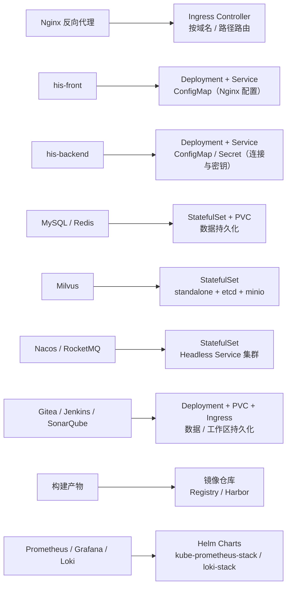

# CSLK-HIS · 三甲医院信息化系统（Hospital Information System）

一套面向三甲医院业务闭环的全栈 HIS：**14 个 Maven 模块的后端**（`his-core-common` / `his-core-spi` 双核心 +
11 个 `his-ms-*` 业务域 + `his-web` 启动层，单一可部署单元）+ Vue 3 管理端 + 微信患者端小程序。覆盖门诊、住院、急诊、
手术麻醉、检验检查、药房药库、收费结算与医保、DRG 3.0 / DIP 分组、护理质控、专科管理、运营分析，以及患者端互联网服务与
18 项 AI 辅助能力。

## 在线演示

- **演示地址**：<http://130995984ggxx.vicp.fun/login>

> 该地址经花生壳内网穿透指向本地虚拟环境，随时可能失效，仅作联调演示用途。登录页「测试账号」弹窗内置演示凭据（密码统一 `123456`）。

## 技术栈

| 层   | 技术                                                                                                                                                                                                           |
|-----|--------------------------------------------------------------------------------------------------------------------------------------------------------------------------------------------------------------|
| 后端  | Java 21 · Spring Boot 3.2.5 · MyBatis-Plus 3.5.6 · MySQL 8 · Redis · **RocketMQ 5.x** · JWT (jjwt 0.12.5) · Knife4j 4.4.0 · Hutool 5.8.26 · OpenPDF / PDFBox / POI · ZXing · Milvus SDK · BouncyCastle (SM2) |
| 支付  | 微信支付（WxJava 4.6.0）· 支付宝 SDK 4.38.0 · 云闪付（聚合扫码 / 回调留痕）                                                                                                                                                         |
| 管理端 | Vue 3.5 · Vite 8.2 · Element Plus 2.14 · Tailwind CSS 4.3 · Pinia 4 · Vue Router 5.3 · Axios · ECharts 6 · sm-crypto                                                                                              |
| 患者端 | 微信小程序（原生，22 个页面 / 4 个 tab）                                                                                                                                                                                       |
| 部署  | Docker Compose（后端 :8009 / 管理端 :3100）+ Nginx                                                                                                                                                                 |
| 数据  | 全量 DDL 快照（`docs/01-初始化DDL/`，23 个领域、**346 张表**）+ 铺底数据（`docs/02-铺底基础数据/`，91 个 SQL 脚本 + 汇总导入）+ 增量脚本（`docs/03-增量SQL变更/`，74 个脚本，编号至 285）                                                                  |

## 业务模块

后端按「his-ms 域架构」切分为 11 个业务域（`com.his.<域>`，域间互不依赖，跨模块访问统一走 `his-core-spi` 端口）：

| 模块             | 领域       | 覆盖内容                                                                                                     |
|----------------|----------|----------------------------------------------------------------------------------------------------------|
| `his-ms-platform` | 平台域     | 组织 / 用户 / 角色 / 岗位 / 菜单权限 / 字典 / 参数 / 操作日志与审计 / 消息 / 工作台 / 科室·病区·诊室 / 设备台账与维护计量 / 电子签名（证书·TSA·令牌）         |
| `his-ms-patient`  | 患者域     | 患者主档 / EMPI 合并 / 标签 / 就诊人 / 医患关系 / 过敏史·既往史·家族史·手术史·用药史 / 体检套餐与结果 / 在线咨询 / 远程会诊                           |
| `his-ms-outpatient`| 门诊域     | 预约挂号 / 号源排班 / 门诊站点 / 分诊 / 排队叫号 / 急诊 / 值班 / 班次 / 考勤 / 人力需求 / 复诊费策略                                        |
| `his-ms-inpatient` | 住院域     | 入院 / 床位分配与等待 / 住院医嘱与执行 / 护理文书与质控 / 转科 / 出院与出院带药 / 住院病历文书 / ICU 监护 / 死亡登记 / 膳食与营养 / 会诊·转诊 / VTE 防治 / 危急值通知 |
| `his-ms-clinical`  | 临床文书域   | 病历 / 病案归档 / 病历质控 / 临床路径 / 处方 / 检查检验申请 / 慢病 / 随访 / 院感 / 公卫上报 / 处方点评 / 不良事件 / 投诉纠纷 / 病历签名 / 单病种 / 治疗记录     |
| `his-ms-medicaltech`| 医技执行域  | 检验 LIS / 检查影像 PACS / 报告 / 危急值 / 心电 / 病理 / 内镜 / 血库输血 / 透析 / 门诊输液 / 医技质控（EQA·LIS）/ 皮肤试验 / 医疗废物 / 医技执行与授权   |
| `his-ms-operation` | 手术麻醉域   | 手术申请 / 手术间 / 器械清点 / 麻醉访视 / 麻醉记录 / PACU 复苏 / 麻醉随访 / 日间手术 / 安全核查 / 麻醉用药                                    |
| `his-ms-charge`    | 收费支付域   | 记账 / 结算 / 优惠 / 医保目录·对照·结算 / 支付渠道（微信·支付宝·银联）/ 退款 / 票据 / 班结日结 / 欠费管控 / **DRG-DIP 分组与模拟** / 病案申诉            |
| `his-ms-pharmacy`  | 药品耗材域   | 药品字典 / 库存 / 调拨 / 发药与退药 / 处方调剂 / 抗菌药物管控 / 采购 / 耗材 / 消毒供应 CSSD / 静配 PIVAS / 盘点 / 药品追溯 / 麻精专册 / 中药代煎        |
| `his-ms-ai`        | AI 能力域   | 知识库 RAG / 智能问答 / 提示词模板 / 评测集与评测运行 / 调用日志 / 检验检查智能解读等18 项能力                                               |
| `his-ms-app`       | 患者端 BFF  | 微信登录 / 挂号预约 / 自助复诊 / 缴费支付 / 报告查询 / 排队 / 押金 / 消息订阅 / 服务工单 / 分诊 / FAQ                                      |

管理端（`source/front`）与患者端小程序（`source/miniapp`）分别消费上述域接口；患者端小程序请求经 `his-ms-app`
BFF 聚合后转发到各业务域。

## 目录结构

```
cslk/
├── source/
│   ├── back_end/                      # Maven 多模块后端（his-ms 域架构，单一可部署单元）
│   │   ├── his-core-common/           #   公共底座：统一响应/分页/基础实体/415 个枚举/异常/MQ 常量/脱敏
│   │   ├── his-core-spi/              #   跨模块契约：端口接口与跨域 VO/DTO（实现在各业务域）
│   │   ├── his-ms-platform/           #   平台域：组织/用户/角色/岗位/权限/字典/审计/消息/签名
│   │   ├── his-ms-patient/            #   患者域：主档/EMPI/就诊人/体检/在线咨询/远程会诊
│   │   ├── his-ms-outpatient/         #   门诊域：预约挂号/号源/分诊/叫号/急诊/值班
│   │   ├── his-ms-inpatient/          #   住院域：入出转/床位/医嘱/护理/ICU/死亡登记
│   │   ├── his-ms-clinical/           #   临床文书域：病历/病案/质控/路径/处方/随访/院感
│   │   ├── his-ms-medicaltech/        #   医技执行域：LIS/PACS/危急值/输血/透析
│   │   ├── his-ms-operation/          #   手术麻醉域：手术/麻醉/PACU/日间手术
│   │   ├── his-ms-charge/             #   收费支付域：记账/结算/支付/医保/DRG-DIP/病案申诉
│   │   ├── his-ms-pharmacy/           #   药品耗材域：字典/库存/调拨/发药/静配/CSSD
│   │   ├── his-ms-ai/                 #   AI 能力域：RAG/智能问答/提示词/调用日志
│   │   ├── his-ms-app/                #   小程序 BFF 聚合层（患者端）
│   │   └── his-web/                   #   唯一启动层（:8080，context-path /api）
│   ├── front/                         # Vue 3 管理端（89 个视图目录 / 516 个 .vue 文件，pnpm dev → :3000）
│   └── miniapp/                       # 微信患者端小程序（22 个页面 / 4 个 tab）
├── docs/
│   ├── 00-开发文档/                    # 需求/设计说明书（docx）、整体架构图、测试账号
│   ├── 01-初始化DDL/                   # 全库 DDL 快照（23 个领域、346 张表，按 01~23 编号）
│   ├── 02-铺底基础数据/                # 铺底数据（91 个 SQL 脚本 + 00_import_all.sql 汇总导入）
│   ├── 03-增量SQL变更/                 # 增量脚本（74 个脚本，编号至 285）
│   └── 10-ER关系图/                    # E-R 关系图、离线查看器、relationships.csv、分域 Mermaid（er-by-domain.md）
├── docker/                            # Docker Compose 部署（后端 :8009 / 管理端 :3100）
├── doc/                               # RAG 知识库原始语料
├── 施工手册与排班/                      # AI 能力施工手册、诊疗闭环手册、排班/DRG 设计文档
├── workspace/                         # 开发期重构、门禁与校验脚本（不参与运行）
└── AGENTS.md                          # 开发规范（前后端契约、命名、鉴权铁律、凭据分流等）
```

## 快速开始

### 前置要求

- JDK 21+、Maven 3.9+
- MySQL 8.0+、Redis 6+
- RocketMQ 5.x
- Node.js 20.19+ 或 22.12+、pnpm
- 微信开发者工具（仅患者端需要）

### 1. 初始化数据库

1. 依次执行 `docs/01-初始化DDL/` 下 `01~23` 编号的领域 DDL（全库建表快照，无 DROP、无数据）。
2. 执行 `docs/02-铺底基础数据/` 的铺底数据：在 mysql 客户端中 `cd` 到该目录后 `source 00_import_all.sql;`，或按需单表执行。
3. 按编号顺序执行 `docs/03-增量SQL变更/` 下的增量脚本（含日期前缀脚本，按文件名排序执行）。

### 2. 启动后端

配置分三层：

- `application.yml`：环境无关公共配置；
- `config/domain/his-*.yml`：领域行为片段（`ai` / `charge` / `followup` / `insurance` / `medicaltech` /
  `platform` / `sms`），dev/pro 共用、零密钥；
- `application-{dev,pro}.yml`：环境差异。`application-dev.yml` 为本地个人配置，不入库。

密钥一律走 `HIS_*` 环境变量（数据库、Redis、JWT、签名主密钥、SM2 私钥、AI 密钥、Milvus、RocketMQ、支付渠道、
短信、医保、随访外呼），完整清单见 `docker/.env.example`。

```bash
cd source/back_end
mvn clean package -DskipTests
java -jar his-web/target/his-backend.jar
# 或 IDE 直接运行 com.his.HisApplication，服务监听 :8080
```

接口文档（Knife4j）：`http://localhost:8080/api/doc.html`

### 3. 启动管理端

```bash
cd source/front
pnpm install
pnpm dev        # 默认 http://localhost:3000
```

dev server 将 `/api` 与 `/uploads` 代理到 `http://localhost:8080`；需要指向其他实例（如另跑一个 jar 做验收）时，用
`VITE_API_TARGET=http://localhost:8082 pnpm dev`，不改配置。

### 4. 患者端小程序

用微信开发者工具导入 `source/miniapp/`，把 `source/miniapp/utils/request.js` 里的 `BASE_URL` 改为你的后端地址
（小程序的真实请求入口只有这一处，需带 `/api` 前缀）。

### 5. Docker 部署（可选）

镜像只装运行时，jar 与前端静态产物都在本机构建后拷入构建上下文（目标机无公网、容器内不拉依赖）：

```bash
# 1) 本机构建产物
cd source/back_end
mvn clean package -DskipTests
cp his-web/target/his-backend.jar ../../docker/backend/his-backend.jar

cd ../front
pnpm install && pnpm build
rm -rf ../../docker/front/dist
cp -r dist ../../docker/front/dist

# 2) 配置并启动
cd ../..
cp docker/.env.example docker/.env   # 填真值（.env 不入库）
docker compose -f docker/docker-compose.yml up -d --build
# 后端 http://localhost:8009/api  ·  管理端 http://localhost:3100
```

影像与导诊单 PDF 写入容器内 `/app/uploads`，compose 已挂载到宿主 `docker/uploads`，重建容器不丢文件。

## 部署架构

### 部署架构总览

单台内网生产服务器承载全部业务与 CI/CD 工具链：业务应用（管理端 + 后端）容器化部署，研发工具链以服务方式运行，
Nginx 作为统一网关入口。



关键调用链：

1. 用户 → Nginx 统一网关 → 管理端 → `/api` → 后端服务；
2. 后端 → MySQL / Redis / RocketMQ / Nacos / Milvus（数据、缓存、消息、配置、向量检索）；
3. 开发提交 Gitea → Jenkins 流水线（拉取代码 → Maven 打包 → SonarQube 扫描 → 构建镜像 → 容器编排发布）；
4. Promtail 采集容器日志 → Loki → Grafana；Prometheus → Grafana（指标看板）。

### K8s 化概念映射

将当前单机部署的组件对应到 Kubernetes 标准对象，便于演进到容器集群：



上 K8s 时发布链路仅需调整最后两步：Jenkins 流水线由「构建镜像 → 容器编排发布」改为「构建镜像 → 推送镜像仓库」+
`kubectl set image`（或 Helm upgrade），前面 拉取代码 → Maven 打包 → SonarQube 扫描 环节完全不变。

## 架构要点

### 模块化单体（14 个 Maven 模块，his-ms 域架构）

系统采用「单一可部署单元、内部按业务域切分」的形态：`his-web`（启动层）→ 11 个 `his-ms-*` 业务域 →
`his-core-spi`（跨模块契约端口）→ `his-core-common`（公共底座），依赖严格单向：**业务域之间互不依赖**，只依赖
common 与 spi。每个业务域内统一分层 `controller / dto / vo / service / service/impl / mapper / entity`
（辅以 `support / config / consumer / trigger / spi`）。保留单进程部署、事务一致、调试简单的好处，不引入跨进程
通信与分布式事务；域边界清晰，为未来按需拆分独立服务留好切面。

### 跨模块访问（his-core-spi 端口）

跨业务域不直接依赖对方模块：端口契约（接口 + 跨域 VO/DTO）统一放 `his-core-spi`，实现放各业务域的 `spi`
包（只依赖本域 mapper，不注入编排服务）。Controller 只做「收 DTO → 调 service → 包统一响应」，业务判断、事务、
数据范围收口都在 service。

### 前后端契约

统一 `{code, message, data}` 响应壳；入参用带校验的 DTO，出参按用途区分 VO（列表 / 详情 / 下拉）。超长整型主键以字符串
形式在前后端之间传递，规避 JS 精度丢失。动词仅保留 `GET / POST / DELETE`，复杂查询统一走 `POST`。

### 鉴权与权限模型

登录口令在前端用 SM2 公钥加密后传输，登录态基于 JWT。权限由菜单数据驱动：同一套权限定义同时约束前端可见性
（菜单 / 按钮 `v-perm`）与后端方法级可达性。**身份 = 一行岗位（角色 × 科室）**，数据范围按岗位从登录态收口，前端不传科室
参数、服务端 fail-closed。401 清 token 回登录，403 只提示、绝不清 token。

### 枚举与字典的双轨

码值到文案只有两条受控出口：**需要在代码里「基于值做分支」（状态机、校验、统计）的用枚举；只用于展示、从不参与分支的用
字典。** 全部 415 个枚举唯一落点在 `his-core-common/src/main/java/com/his/common/enums`，字典类型编码统一由
`DictTypeConst` 提供。

### 收费四层与药品两层库位

- 收费：L1 记账（`biz_fee_record`）→ L2 结算（`biz_settlement_bill`）→ L3 支付（`biz_payment_txn` /
  `biz_fund_account`）→ L4 票据与对账（发票、班结 / 日结、渠道勾对）。记账行不可改，错账只红冲；统筹与院内优惠分列；
  碰钱的写操作接幂等键。DRG 3.0 / DIP 分组与模拟在 `his-ms-charge`。
- 药品：`stock_room` 区分药库 / 药房，药进药房只走调拨单；退药、退库、供应商退货构成三级逆向链，每步都落库存流水。

### 异步消息

RocketMQ 承担操作审计日志异步落库（`HIS_AUDIT_LOG`，消费者在 `his-ms-platform`）与收费账单支付事件
（`HIS_CHARGE_BILL_PAID`，消费者在 `his-ms-charge`）；Topic 与消费组常量统一在 `his-core-common` 的
`HisMqTopics`。

### 电子签名与合规

内置院内托管证书与电子签名 / 验签能力（`his-ms-platform`），用于病历、处方、检查申请等需留痕且不可抵赖的业务对象；
签名覆盖范围与内容哈希独立校验，改了内容再验签必须失败。时间源当前默认本机时钟，授时服务器 / 第三方 TSA 在配置中预留、
尚未接入。

### AI 能力的接入哲学

AI 不是嵌入业务代码的黑盒，而是一层「横切能力」（`his-ms-ai`）：业务模块不得依赖 AI 模块，由 AI 层反向读取业务数据来
产出候选。核心纪律：

- 能力白名单调用，模型不得自主选择能力；
- 事实必须由确定代码判定，模型只负责解释与生成候选；
- 模型不可用时必须能降级为纯规则 / 人工兜底，且降级对用户可见；
- 全部模型调用经唯一入口并落审计，送模型内容先脱敏。

知识库 RAG 支持 Milvus 向量库与文档版本管理，运营问数是唯一允许模型产出 SQL 的能力，必须过 SQL 白名单闸门。

### 配置与凭据隔离

代码与配置入库零密钥：环境口令一律走 `HIS_*` 环境变量，`application-dev.yml` 与 `docker/.env` 不入库。配置分三层——
公共基础、领域行为片段（dev/pro 共用、零密钥）、环境差异，保证不同环境结构一致、仅值不同。

### 数据治理基线

数据库结构以「全量 DDL 快照 + 铺底基础数据 + 编号递增增量脚本」三段式管理，是前后端与验证脚本唯一对齐的数据源。逻辑删除、
审计字段、时间与金额口径等跨表约定由统一基类与工具收敛。

## 文档索引

### 架构与总览

- [整体架构图](docs/00-开发文档/整体架构图.html) — 可离线打开的架构图（历史设计稿，按模块合并前绘制；当前模块结构以本文「架构要点」为准）

### 数据库与数据建模

- [初始化 DDL 快照](docs/01-初始化DDL/) — 23 个领域、346 张表的建表基线
- [铺底基础数据](docs/02-铺底基础数据/) — 91 个 SQL 脚本 + `00_import_all.sql` 汇总导入
- [增量 SQL 变更](docs/03-增量SQL变更/) — 74 个脚本的演进记录（编号至 285，另有日期前缀脚本）
- [E-R 关系图](docs/10-ER关系图/) — 离线查看器 `index.html`、`relationships.csv`、分域 Mermaid（`er-by-domain.md`）

### 需求与设计文档

- `docs/00-开发文档/` 下：需求规格说明书、用户需求说明书、业务架构设计说明书、概要设计说明书、详细设计说明书（docx）

### 开发规范

- [AGENTS.md](AGENTS.md) — 前后端契约、命名、鉴权铁律、凭据分流等全局开发规范

## 作者与联系方式

- **作者**：隔壁老柴（GitHub: [@cslaochai](https://github.com/cslaochai)）
- **邮箱**：1043188782@qq.com
- **问题反馈**：优先在仓库提交 Issue；内部协作者可通过 Gitea 仓库直接联系。

## License

私有项目，保留所有权利。
