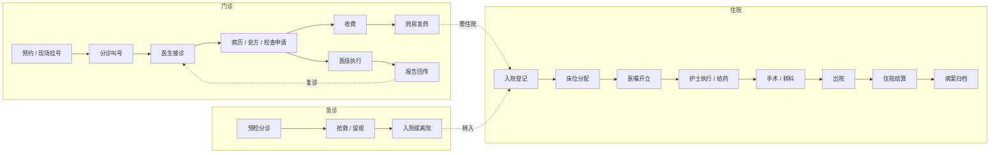
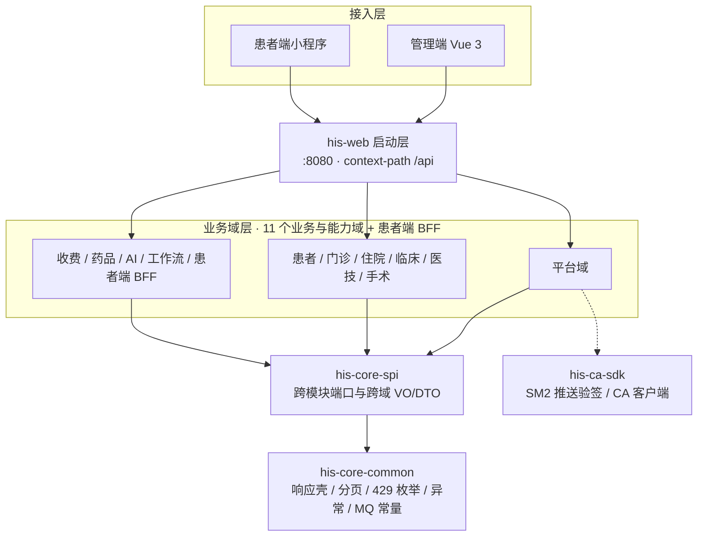

<h1 align="center">CSLK-HIS</h1>

<p align="center"><b>面向三甲医院真实业务链路的全栈医院信息系统</b></p>

<p align="center">
  
  
  
  
  
  
</p>

<p align="center">
  <a href="#项目简介">项目简介</a> ·
  <a href="#业务全景">业务全景</a> ·
  <a href="#功能特性">功能特性</a> ·
  <a href="#角色与权限">角色</a> ·
  <a href="#技术栈">技术栈</a> ·
  <a href="#系统架构">架构</a> ·
  <a href="#快速开始">快速开始</a> ·
  <a href="#常见问题">常见问题</a> ·
  <a href="#文档">文档</a>
</p>

## 项目简介

CSLK-HIS 是一套按三甲医院真实业务链路组织的全栈医院信息系统：后端是 16 个 Maven 模块的模块化单体，
管理端使用 Vue 3，患者侧是微信小程序。系统从挂号接诊一路覆盖到出院结算，并把医保结算、DRG 3.0 / DIP 分组、
电子签名、护理质控、AI 辅助等能力接在真实单据流上，而不是做成彼此独立的功能页。

它适合三类读者：

- **医院信息科 / HIS 厂商交付团队**：需要一套结构完整、状态机清晰、可直接二次开发的底座。
- **后端与全栈开发者**：想理解一套 HIS 从门诊、住院、医技、药事到收费医保的完整数据流。
- **医疗信息化学习者**：希望对照真实单据、真实字典、真实结算链路理解医院业务，而不是只看 Demo。

### 设计目标

- **业务闭环，不是功能拼盘**：门诊、住院、急诊、手术、医技、药房、收费、医保按真实单据流与状态机串起来，
  每一次状态流转都能在数据里找到依据。
- **模块化单体，边界可验证**：单进程部署、事务一致；11 个业务与能力域之间零依赖，跨域只走 `his-core-spi`
  端口，避免“微服务化”之后又把事务拆散。
- **数据可回放**：全量 DDL、铺底数据、编号增量三段式管理，新环境能从空库一路建到可用状态。
- **AI 可降级**：模型只负责解释、生成候选和意图路由，事实判定仍由确定代码完成；模型不可用时回落规则或人工。

### 项目规模

| 维度 | 规模 |
|---|---|
| 后端 | 16 个 Maven 模块，429 个枚举，单一可部署单元 |
| 管理端 | 93 个视图目录，604 个 `.vue` 文件 |
| 患者端 | 27 个页面，4 个 tab |
| 数据库 | 24 个业务领域，363 张表，99 张表的基础数据 |
| E-R | 905 条关系，其中 748 条有 A/B 级数据证据 |

## 业务全景

系统围绕“患者一次到院”组织，门诊、住院、急诊三条主线共用患者主索引、收费、药房与医技资源：



贯穿三条主线的还有四张“公共底牌”：

- **患者主索引**：患者、就诊人、EMPI 合并、过敏与既往史，一次建档全院复用。
- **收费四层**：记账 → 结算 → 支付 → 票据对账，临床单据与资金流水分离。
- **药品双库位**：药库 / 药房两级库存，发药、退药、调拨、退货都有库存流水。
- **岗位身份**：一行岗位 = 员工 × 角色 × 科室，数据范围随当前岗位收口。

## 功能特性

### 门诊与预约

- 预约挂号、现场挂号、号源池与排班模板，支持按科室、医生、时段放号。
- 分诊叫号、门诊站点与站点派岗，候诊队列按诊室与叫号规则推进。
- 医生站：病历、诊断、处方、检查检验申请、处置与治疗申请。
- 门诊收费、退费、发票，复诊费策略与欠费管控。
- 复诊随访、在线咨询、报告解读。

### 住院与护理

- 入院登记、床位分配与等床队列、转科、出院与带药。
- 长期 / 临时医嘱开立、审核、执行、停止与计费。
- 护理文书、护理评估、护理排班（病区编制 → 片区审核 → 护理部备案）。
- 住院病历、病程记录、会诊、ICU 监护、膳食营养、死亡登记。
- 住院预交金、一日清单、出院结算。

### 急诊与体检

- 预检分诊、急诊抢救、留观、急诊病历与急诊收费。
- 全院总值班：值班类型、值班线、呼叫单与呼叫流水。
- 体检套餐、体检项目、体检报告与总检。

### 医技与报告

- 检验 LIS：申请、标本、结果、质控、危急值、室间质评。
- 检查 PACS：预约、登记、影像报告、心电、病理、内镜。
- 输血与血库：配血、发血、输血反应、血袋追溯。
- 透析、门诊输液、皮肤试验、医技质控与医疗废物。

### 手术麻醉

- 手术申请、手术间排程、术前准备、器械清点。
- 麻醉访视、麻醉记录、麻醉用药、PACU 复苏、麻醉随访。
- 日间手术评估、手术安全核查。

### 药品与耗材

- 药品字典、药库 / 药房库存、采购、调拨、盘点。
- 门诊与住院发药、退药、处方调剂、静配 PIVAS、中药代煎。
- 抗菌药物分级、麻精专册、药品追溯。
- 耗材与消毒供应 CSSD：请领、清洗、打包、灭菌、发放。

### 收费、医保与 DRG/DIP

- 收费四层：记账、结算、支付、票据与班结 / 日结。
- 医保目录、对照、备案、结算、审核、报盘与合规审计。
- 微信支付、支付宝、云闪付聚合扫码与回调留痕。
- DRG 3.0 / DIP 分组、模拟结算、病案申诉与医疗支付。

### 平台、合规与 AI

- 组织、用户、角色、岗位、菜单权限、字典、参数、操作审计。
- 统一消息、统一待办、工作台卡片。
- 院内软签 + CA 在线签名、时间戳令牌台账、医生证书管理。
- 病案归档、病历质控、临床路径、单病种、VTE、抗菌药物专项。
- 工作流：流程定义、实例、待办、流转轨迹，节点支持审批 / 自动 / 网关。
- AI：知识库 RAG、智能问答、提示词模板、评测集，18 项业务能力统一白名单与审计。

## 角色与权限

系统不预设“超级账号做所有事”，而是按医院岗位拆分职责。登录后可在顶栏切换岗位，数据范围随岗位变化。

| 角色 | 典型岗位 | 主要操作 |
|---|---|---|
| 系统管理员 | 信息科 | 组织、用户、角色、菜单、字典、参数、审计 |
| 医务管理 | 医务科 / 质控科 | 医师授权、病历质控、病案审核、临床路径 |
| 医生 | 门诊 / 住院医师 | 接诊、病历、诊断、处方、医嘱、检查申请 |
| 护士 | 病区护士 / 护士长 | 分诊、执行医嘱、护理文书、排班、床位 |
| 收费员 | 收费处 | 挂号收费、门诊 / 住院结算、退费、发票、日结 |
| 药师 | 药房 / 药库 | 调拨、发药、退药、盘点、处方审核、静配 |
| 医技技师 | 检验 / 影像 / 心电 | 登记、执行、报告、危急值、质控 |
| 病案质控 | 病案室 | 首页编码、归档、质控评分、DRG/DIP 入组 |
| 患者 | 微信小程序 | 预约、缴费、报告、排队、问卷、消息 |

## 核心业务规则

HIS 的难点不在页面，而在“钱、药、床位、病历”四件事的口径。下面这些规则在代码与数据基线上是硬约束，
不是靠操作员记流程。

**收费分四层，临床单据与资金流水分离**

- L1 记账：临床发生的费用落 `biz_fee_record`，记录“谁该付多少、来自哪张单据”。记账行写入后不可改，错账只能红冲。
- L2 结算：把记账行合成账单，算优惠、医保统筹、个账与自付，形成应缴金额。
- L3 支付：一笔钱一行流水，收正退负，收退同表；付清由“成功收款合计 ≥ 应缴”现算，不靠按钮翻状态。
- L4 票据与对账：发票、班结、日结、渠道勾对，对账事实只来自 L3 支付流水。

**退费只退钱，不替药师退药**

退费发起前必须确认药品已退（发药单状态回到“已退药”），否则闸门直接拒绝。已发药、已退药的行不会被退费逻辑改写，
避免“钱退了、药还在患者手里”。

**药品两级库位，逆向链每一步都留流水**

`stock_room` 区分药库与药房，药进药房只能走调拨单。患者退药、药房退库 / 药库下拨、供应商退货构成三级逆向链，
调拨单一张单出两行流水、合计为零，按单据而非批次核对。

**住院以“账单状态”驱动临床动作**

签到、发药、执行读的是账单是否结清，而不是收费单状态。免收、0 元单、后付费因此不需要在支付层造假；
预交金、一日清单、出院结算各自独立，出院结算不反向锁死病历归档。

**医保结算：统筹不是支付方式**

医保统筹由医保局后付，走账单的统筹列与报盘，不进支付流水；`4-医保个账` 才是真实收款。院内优惠与医保拆分分列，
避免“统筹塞进优惠列”导致现金清点对不上。

**身份 = 岗位，数据范围随岗位收口**

一行岗位 = 员工 × 角色 × 科室，每人恰有一条主岗位。切换岗位必须携带角色与科室且岗位存在，否则拒绝发令牌并写审计；
数据范围由服务端按当前岗位计算，前端不传科室参数，也不提供“全院”开关。

**质控与签名是流程闸门，不是事后补录**

病历提交前跑规则质控与内涵质控，命中否决项要求二次确认；病案归档前完成首页编码与质控评分。签名采用院内软签 +
CA 在线签名，时间戳令牌单独台账，满足“签名时证书仍有效”的留痕要求。

## 标准与编码

| 标准 / 编码 | 系统落点 | 用途 |
|---|---|---|
| ICD-10 | `sys_icd10` 诊断字典 | 门诊 / 住院诊断、病案首页、DRG/DIP 入组 |
| ICD-9-CM3 | 手术与操作字典 | 手术申请、麻醉记录、病案首页手术编码 |
| 医保目录 | 医保目录与对照表 | 药品 / 耗材 / 诊疗项目对照、结算与报盘 |
| DRG 3.0 / DIP | 分组器与病种目录 | 分组模拟、结算差异、病案申诉 |
| 诊疗科目名录 | `sys_med_subject` + 科室映射 | 病案首页、卫统与医保上报的标准科别出口 |
| 国密 SM2 / SM3 / SM4 | `his-ca-sdk`、签名与证书模块 | 电子签名、CA 验签、数据加密 |
| 卫统 / 病案首页 | 上报与归档模块 | 出院病案首页、卫统报表、医保结算清单 |

## 技术栈

### 后端

| 技术 | 版本 | 用途 |
|---|---|---|
| Java | 21 | 运行时 |
| Spring Boot | 3.2.5 | Web、事务、配置、Actuator |
| Spring Security | 6.x | 认证、方法级鉴权、数据范围 |
| MyBatis-Plus | 3.5.6 | ORM、分页、逻辑删除 |
| JWT (jjwt) | 0.12.5 | 无状态登录令牌 |
| Knife4j | 4.4.0 | OpenAPI 接口文档 |
| Hutool | 5.8.26 | 通用工具 |
| BouncyCastle | 1.78 | SM2 / 国密、签名验签 |
| OpenPDF / PDFBox / POI | — | 单据、报告、病案导出 |
| WxJava | 4.6.0 | 微信登录与支付 |
| 支付宝 SDK | 4.38.0 | 支付、退款、对账 |

### 数据与中间件

| 技术 | 用途 |
|---|---|
| MySQL 8 | 业务主库，按 24 个业务领域组织 |
| Redis | 会话、权限缓存、字典缓存、分布式锁 |
| RocketMQ 5.x | 操作审计落库、账单支付事件 |
| Milvus | 知识库向量检索（RAG） |

### 管理端

| 技术 | 版本 | 用途 |
|---|---|---|
| Vue | 3.5.41 | 前端框架 |
| Vite | 8.2.2 | 构建与开发服务器 |
| Element Plus | 2.14.5 | 中后台组件 |
| Tailwind CSS | 4.3.3 | 原子化样式 |
| Pinia | 4.0.3 | 全局状态 |
| Vue Router | 5.3.1 | 路由与权限守卫 |
| Axios | — | 请求封装、统一错误处理 |
| ECharts | 6.1 | 工作台与统计图表 |
| sm-crypto | — | 前端国密辅助 |

### 患者端与部署

| 技术 | 用途 |
|---|---|
| 微信小程序（原生） | 27 个页面、4 个 tab，经 `his-ms-app` BFF 聚合 |
| Docker Compose | 后端 + 管理端 + Nginx 一键编排 |
| Nginx | 静态资源与 `/api` 反向代理 |
| Prometheus / Grafana / Loki | 指标、日志与看板 |

## 系统架构

### 模块化单体

单进程部署、内部按业务域切分。依赖严格单向：启动层 → 业务域 → 跨模块契约 → 公共底座；业务域之间互不依赖。



一条硬规则：**业务域之间不互相 import**。需要读别的域的数据，就在 `his-core-spi` 定义端口，由数据宿主模块实现；
端口实现只依赖本模块 mapper，不注入编排 Service，避免拖出 Bean 环。

### 模块职责

| 模块 | 领域 | 核心内容 |
|---|---|---|
| `his-ms-platform` | 平台域 | 组织 / 用户 / 角色 / 岗位 / 菜单权限 / 字典 / 参数 / 审计 / 消息 / 工作台 / 科室病区诊室 / 设备台账 / 电子签名与 CA 证书 |
| `his-ms-patient` | 患者域 | 患者主档 / EMPI 合并 / 标签 / 就诊人 / 医患关系 / 过敏史与既往史 / 体检套餐与结果 / 在线咨询 / 远程会诊 |
| `his-ms-outpatient` | 门诊域 | 预约挂号 / 号源排班 / 门诊站点 / 分诊 / 排队叫号 / 急诊 / 值班 / 班次 / 考勤 / 人力需求 / 复诊费策略 |
| `his-ms-inpatient` | 住院域 | 入院 / 床位分配与等待 / 住院医嘱与执行 / 护理文书与质控 / 转科 / 出院与带药 / ICU 监护 / 死亡登记 / 膳食营养 / 会诊转诊 / VTE |
| `his-ms-clinical` | 临床文书域 | 病历 / 病案归档 / 病历质控 / 临床路径 / 处方 / 检查检验申请 / 慢病 / 随访 / 院感 / 公卫上报 / 处方点评 / 不良事件 / 单病种 |
| `his-ms-medicaltech` | 医技执行域 | 检验 LIS / 检查影像 PACS / 报告 / 危急值 / 心电 / 病理 / 内镜 / 血库输血 / 透析 / 门诊输液 / 医技质控 / 皮肤试验 / 医疗废物 |
| `his-ms-operation` | 手术麻醉域 | 手术申请 / 手术间 / 器械清点 / 麻醉访视 / 麻醉记录 / PACU 复苏 / 麻醉随访 / 日间手术 / 安全核查 / 麻醉用药 |
| `his-ms-charge` | 收费支付域 | 记账 / 结算 / 优惠 / 医保目录对照结算 / 微信支付宝银联 / 退款 / 票据 / 班结日结 / 欠费管控 / DRG-DIP 分组模拟 / 病案申诉 |
| `his-ms-pharmacy` | 药品耗材域 | 药品字典 / 库存 / 调拨 / 发药退药 / 处方调剂 / 抗菌药物 / 采购 / 耗材 / CSSD / 静配 PIVAS / 盘点 / 药品追溯 / 麻精专册 / 中药代煎 |
| `his-ms-ai` | AI 能力域 | 知识库 RAG / 智能问答 / 提示词模板 / 评测集与评测运行 / 调用日志 / 18 项业务能力 |
| `his-ms-workflow` | 工作流域 | 流程定义（审批流 / AI 集成流）/ 流程实例 / 待办与流转轨迹 / 统一待办聚合 |
| `his-ms-app` | 患者端 BFF | 微信登录 / 挂号预约 / 自助复诊 / 缴费 / 账单 / 报告 / 体检 / 检查预约 / 发票 / 问卷 / 排队 / 押金 / 消息订阅 / 分诊 / FAQ |

### 部署形态

开发环境直接跑 `his-web`（8080）；生产用 Docker Compose 起后端、管理端与 Nginx（后端 8009、管理端 3100、Nginx 80）。
中间件 MySQL / Redis / RocketMQ / Milvus 独立部署，配置通过环境变量注入，代码里不落密钥。

## 目录结构

```text
cslk/
├── source/
│   ├── back_end/                    # 16 个 Maven 模块，单一可部署单元
│   │   ├── his-core-common/         #   公共底座：响应 / 分页 / 基础实体 / 枚举 / 异常 / MQ 常量
│   │   ├── his-core-spi/            #   跨模块契约：端口接口与跨域 VO/DTO
│   │   ├── his-ca-sdk/              #   CA 对接 SDK
│   │   ├── his-ms-*/                #   11 个业务与能力域 + 患者端 BFF
│   │   └── his-web/                 #   启动层（:8080 · /api）
│   ├── front/                       # Vue 3 管理端
│   └── miniapp/                     # 微信患者端小程序
├── docs/
│   ├── 00-开发文档/                  # 需求、概要、详细设计、架构图、工作流设计
│   ├── 01-初始化DDL/                 # 24 个领域、363 张表的建表基线
│   ├── 02-铺底基础数据/              # 99 张表的初始化数据
│   ├── 03-增量SQL变更/               # 编号 + 日期前缀的结构演进脚本
│   ├── 10-ER关系图/                  # 离线查看器、关系明细、分域 Mermaid
│   └── 12-部分流程图/                # 诊疗闭环、质控体系、AI 能力全景
├── docker/                          # Compose 与 Nginx 配置
└── AGENTS.md                        # 开发规范
```

## 快速开始

### 环境要求

| 组件 | 版本 | 说明 |
|---|---|---|
| JDK | 21+ | 后端编译与运行 |
| Maven | 3.9+ | 多模块构建 |
| MySQL | 8.0+ | 业务库，字符集 utf8mb4 |
| Redis | 6+ | 会话、权限与字典缓存 |
| RocketMQ | 5.x | 审计与支付事件（不启动不影响主流程，但审计会缺） |
| Node.js | 20.19+ 或 22.12+ | 管理端构建 |
| pnpm | 8+ | 前端包管理 |
| 微信开发者工具 | 最新 | 仅患者端需要 |

### 1. 初始化数据库

准备一个空库（例如 `hn_biz_his`，字符集 `utf8mb4`），按顺序执行三段脚本：

```bash
# ① 建表：24 个领域文件，无 DROP、无数据
mysql -u root -p 库名 < docs/01-初始化DDL/01-系统基础（组织·用户·岗位·权限·参数·字典）.sql
# …… 依次执行 01 ~ 24 号文件

# ② 铺底：99 张表的基础数据，根目录脚本串起全部领域
cd docs/02-铺底基础数据
mysql --default-character-set=utf8mb4 -u root -p 库名 < 00_import_all.sql

# ③ 增量：154 个脚本，按文件名顺序执行
cd ../../03-增量SQL变更
for f in $(ls *.sql | sort); do mysql -u root -p 库名 < "$f"; done
```

顺序不能反：铺底脚本依赖建表，增量脚本依赖铺底的基础数据。执行完可用
`SELECT COUNT(*) FROM information_schema.TABLES WHERE TABLE_SCHEMA='库名'` 核对表数（基线 363 张）。

### 2. 启动后端

配置分三层：`application.yml`（公共）、`config/domain/his-*.yml`（领域行为片段）、
`application-{dev,pro}.yml`（环境差异）。数据库、Redis、JWT 等敏感项一律走 `HIS_*` 环境变量，
开发环境可在 IDE 的 Run Configuration 或 shell 里设置。

```bash
cd source/back_end
mvn clean package -DskipTests
java -jar his-web/target/his-backend.jar
# 或在 IDE 中运行 com.his.HisApplication
```

启动成功后：

- 业务接口：`http://localhost:8080/api`
- 接口文档：`http://localhost:8080/api/doc.html`

影像、处方、报告 PDF 与证书不落源码目录，由 `his.upload.base-dir` 指定数据根目录；开发环境通常指向
`source/cslk-data/`（`uploads/` 存文件、`crypto/` 存证书）。

### 3. 启动管理端

```bash
cd source/front
pnpm install
pnpm dev        # http://localhost:3000
```

开发服务器会把 `/api` 与 `/uploads` 代理到 `http://localhost:8080`。后端不在本机时：

```bash
VITE_API_TARGET=http://192.168.1.10:8080 pnpm dev
```

### 4. 患者端小程序

用微信开发者工具导入 `source/miniapp/`，把 `source/miniapp/utils/request.js` 里的 `BASE_URL`
改成后端地址。它是唯一请求入口，地址必须带 `/api` 前缀。

### 5. Docker Compose 部署

镜像只装运行时，jar 与前端产物在本机构建后拷入构建上下文：

```bash
# 构建后端
cd source/back_end
mvn clean package -DskipTests
cp his-web/target/his-backend.jar ../../docker/backend/his-backend.jar

# 构建管理端
cd ../front
pnpm install && pnpm build
rm -rf ../../docker/front/dist
cp -r dist ../../docker/front/dist

# 配置并启动
cd ../..
cp docker/.env.example docker/.env      # 填真实值，.env 不入库
docker compose -f docker/docker-compose.yml up -d --build
```

启动后：管理端 `http://localhost:3100`，后端 `http://localhost:8009/api`，Nginx 统一入口 `:80`。

## 配置说明

最少启动需要下面这些环境变量；完整清单（支付、短信、医保、呼叫中心等）见 `docker/.env.example`。

| 变量 | 用途 | 是否必填 |
|---|---|---|
| `HIS_DB_URL` | JDBC 连接串，含库名与时区 | 是 |
| `HIS_DB_USERNAME` / `HIS_DB_PASSWORD` | 数据库账号 | 是 |
| `HIS_REDIS_HOST` / `HIS_REDIS_PASSWORD` | Redis 地址与密码 | 是 |
| `HIS_JWT_SECRET` | 登录令牌签名密钥 | 是 |
| `HIS_SIGN_SECRET` | 业务签名与软签密钥 | 是 |
| `HIS_ROCKETMQ_NAME_SERVER` | RocketMQ 地址 | 审计/支付事件需要 |
| `HIS_INSURANCE_MODE` / `HIS_INSURANCE_BASE_URL` | 医保联调模式与前置地址 | 医保结算需要 |
| `HIS_MILVUS_URL` / `HIS_MILVUS_TOKEN` | 向量库地址与令牌 | RAG 需要 |
| `HIS_AI_API_KEY` | 模型服务密钥 | AI 能力需要 |
| `WX_PAY_*` / `ALIPAY_*` / `UNIONPAY_*` | 支付渠道商户参数 | 对应渠道需要 |

> 密钥只从环境变量读，代码与仓库里不保存任何真实凭据；`docker/.env` 已在忽略列表中。

## 在线演示

- **演示地址**：<http://130995984ggxx.vicp.fun/login>
- **测试账号**：登录页「测试账号」弹窗内置演示凭据，密码统一 `123456`
- **接口文档**：本地启动后 `http://localhost:8080/api/doc.html`

> 演示地址经内网穿透指向本地虚拟环境，随时可能失效，仅作联调演示用途。

## 常见问题

**初始化时报 `Table doesn't exist`**
顺序错了。必须先跑 `docs/01-初始化DDL` 建表，再跑 `docs/02-铺底基础数据`，最后跑 `docs/03-增量SQL变更`。

**写库时报 `1364 Field 'create_by' doesn't have a default value`**
基线的审计列刻意不留默认值，需要先在目标库执行 `docs/03-增量SQL变更/20261023_姓名与操作人NOT_NULL列剥掉DEFAULT.sql`
让活库列形状与基线一致。

**登录成功但页面空白 / 接口 403**
先确认 Redis 可用（权限与字典走缓存）；再检查当前岗位是否有该页面的按钮权限。403 只提示、不会清登录态；
401 才是令牌失效。

**审计日志没有落库**
检查 RocketMQ 是否启动、`HIS_ROCKETMQ_NAME_SERVER` 是否正确。审计走 `HIS_AUDIT_LOG` 主题，消费端在
`his-ms-platform`。

**小程序请求 404**
`BASE_URL` 必须带 `/api` 前缀，并确保手机 / 开发者工具能访问到后端所在网络。

**端口被占用**
后端 8080、管理端 3000、Docker 后端 8009、Docker 管理端 3100。改端口时同步改前端代理
`VITE_API_TARGET` 或 Nginx 配置。

**演示地址打不开**
内网穿透地址会变，以本地启动为准；需要对外演示时重新生成穿透映射。

## 文档

| 文档 | 内容 |
|---|---|
| [整体架构图](docs/00-开发文档/整体架构图.html) | 可离线打开的架构图（历史设计稿，模块结构以本文为准） |
| [需求与设计文档](docs/00-开发文档/) | 需求规格、用户需求、业务架构、概要设计、详细设计、角色岗位菜单模型 |
| [工作流模块设计与用法](docs/00-开发文档/工作流模块-设计与用法.md) | 节点类型、流转规则、AI 节点接入 |
| [初始化 DDL](docs/01-初始化DDL/) | 24 个领域、363 张表的建表基线 |
| [铺底基础数据](docs/02-铺底基础数据/) | 99 张表的初始化数据与导入顺序 |
| [增量 SQL 变更](docs/03-增量SQL变更/) | 154 个结构演进脚本 |
| [E-R 关系图](docs/10-ER关系图/) | 离线查看器、905 条关系明细、24 个分域 Mermaid |
| [部分流程图](docs/12-部分流程图/) | 诊疗闭环全景、质控体系、AI 能力全景、急诊响应形态、代码级缺口清单 |

## 开发约定

- **跨域只走端口**：业务域之间不直接 import，契约放 `his-core-spi`，实现在数据宿主模块。
- **一列一枚举**：码值统一落 `his-core-common` 的 `enums`，字典类型编码统一由 `DictTypeConst` 提供。
- **Controller 只做转发**：收 DTO → 调 service → 包统一响应；业务判断、事务、数据范围收口都在 service。
- 命名、鉴权、SQL、脱敏与凭据规则以 [AGENTS.md](AGENTS.md) 为准。

## 作者与许可

- **作者**：隔壁老柴（GitHub [@cslaochai](https://github.com/cslaochai)）
- **邮箱**：1043188782@qq.com
- **问题反馈**：优先提交 Issue；内部协作者可通过 Gitea 仓库联系
- **License**：私有项目，保留所有权利
