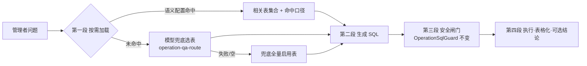
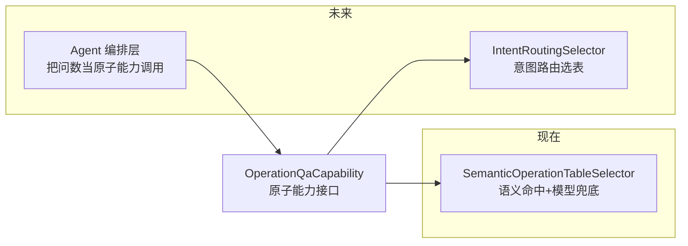

# AI 运营问数：按需加载与语义配置设计

> 版本：v2.0（2026-10-12）  ·  对应增量 SQL：`docs/03-增量SQL变更/245-AI运营问数配置落库.sql`

## 1. 背景与现状问题

运营问数（NL2SQL）原实现把 11 张经营表的 schema **硬编码在 Java 常量**（`OperationSchemaCatalog`），
每次请求**全量拼接**进提示词，模型现场猜业务口径。问题：

1. **schema 硬编码**：加表/改列要改代码发版；手写列注释与真实 DDL 漂移。
2. **全量注入**：白名单扩到 20~30 张表后 prompt 膨胀、token 成本上涨、注意力稀释，准确率下降。
3. **无权威口径**："收入"算哪张表哪列、"门诊量"怎么数，全靠模型猜 + 提示词写死，改口径要改模板。

## 2. 目标链路

生成段只注入**相关表的 schema + 命中语义口径**，三张配置表由管理端维护，变更即时生效。

## 3. 配置模型（三张表）

| 表 | 职责 | 关键字段 |
|---|---|---|
| `sys_ai_qa_schema` | 可查询表（白名单）表级配置 | table_name、table_desc（喂模型的用途说明）、is_enabled、sort_order |
| `sys_ai_qa_column` | 列级配置 | column_name、column_desc（来自真实 DDL COMMENT）、is_filterable（可否做 WHERE）、is_groupable、is_enabled（是否喂模型） |
| `sys_ai_qa_semantic` | 语义映射（业务口径权威来源） | term（语义词）、table_name、column_name（可空=表级）、scope_desc（口径说明）、match_mode（1-包含 2-精确）、priority |

设计要点：

- **唯一键含 `del_flag`**：软删后可重建同名配置，不冲突。
- **列含义取自真实 DDL COMMENT**（铺底时从 `docs/01-初始化DDL` 提取），管理端可维护。
- **患者个人信息列（姓名/手机号/身份证等）与审计列默认停用**，不进入模型提示词。
- **运行时按需查库（无内存快照）**：启动零加载、变更零刷新 —— 问数链路每次直接查
  `sys_ai_qa_schema / sys_ai_qa_column / sys_ai_qa_semantic`（毫秒级），配置表即唯一事实来源。
  `OperationSchemaCatalog` 只是无状态文本组装工具（schemaText/catalogText/semanticText）。
- **重写刷新（表结构同步唯一入口）**：`POST /ai/operationQa/config/rewriteSchema` 扫描
  information_schema 全库 BASE TABLE，一次性覆盖表/列配置 —— 表级对齐全库表（新表默认停用
  不进白名单、保留既有启用状态与用途说明、库中已删表物理删）；列级对齐真实 DDL（新列默认启用、
  注释/类型覆盖、已删列物理删、`column_type` 来自 data_type）。**日常改表结构不会自动同步**，
  只有点「重写刷新」才入库。

## 4. 按需加载机制

`OperationTableSelector` 接口（`com.his.ai.service`），当前实现 `SemanticOperationTableSelectorImpl`：

1. **语义命中优先**（无额外调用）：按需查库取启用语义，包含匹配（问题文本含 term）/ 精确匹配，
   命中 → 收集相关表 + 命中口径（按 priority 降序）。
2. **模型兜底**（仅语义未命中时触发）：轻量模型从表目录（表名+用途，查库组装）选表，输出 JSON 数组，
   逐表过白名单校验（查库取启用表集合），失败即弃。
3. **兜底全量**：两步都未选出 → 回到旧的全量注入行为（行为等价，不影响可用性）。

**已知局限（第一版接受，文档留痕）**：
- 语义命中集合可能缺 join 维度表（如"收入按科室"命中 settlement_bill，但其无科室列）。
  缓解：铺底了"科室/床位"等维度词条目，命中即补维度表；仍未覆盖的靠模型兜底/人工加词条。
- 包含匹配有误命中可能（如"手术"命中手术量词条），但口径只是提示、SQL 仍过闸门，风险可控。

## 5. 扩展点（未来意图路由 / Agent 工作流）

- **意图路由**：选表已抽象为 `OperationTableSelector` 接口，未来新增 `IntentRoutingSelectorImpl`
  替换即可，生成段无感知；语义映射表预留 `term/priority` 可扩展为意图-表映射。
- **Agent 工作流**：`OperationQaCapability` 保持原子接口（问题进、结果 VO 出），
  未来 Agent 编排层可把它作为子任务调用；`OperationTableSelection.routeDesc` 记录了路由方式，
  可上抛给 Agent 做过程解释。

## 6. 变更点清单

**SQL**：`docs/03-增量SQL变更/245-AI运营问数配置落库.sql`（三张配置表 + 11 表铺底 + 17 条语义铺底 + 菜单按钮 `ai:operationQa:config`，仅授管理员）+ `246-AI运营问数列类型列.sql`（幂等加 `column_type`）。

**后端（his-ai）**：
- `support/OperationSchemaCatalog`：静态硬编码 → 无状态文本组装工具（record 定义 + schemaText/catalogText/semanticText，不持有数据）。
- `service/OperationTableSelector` + `service/impl/SemanticOperationTableSelectorImpl`：按需选表（语义/白名单/表目录查库）。
- `service/OperationQaConfigService` + `impl`：三张配置 CRUD + 运行时查询（enabledTableNames/tableDefs/semanticDefs）+ 重写刷新（rewriteSchema）。
- `service/impl/OperationQaCapabilityImpl`：两段式（先选表、再生成，生成段查库注入相关表 schema + 命中语义），空配置 fail-closed；闸门白名单入参传查库结果。
- `support/OperationSqlGuard`：白名单集合改为入参（纯函数，不持有内存数据）。
- `controller/AiOperationQaConfigController`：配置管理接口（`ai:operationQa:config`，含 `rewriteSchema`）。
- 提示词：`operation-qa.md`（v2.0，新增 `{{semantics}}` 业务口径段、列带类型）、新增 `operation-qa-route.md`（选表路由）。

**前端**：
- `src/api/ai.js`：问数配置接口（schema/column/semantic CRUD + 下拉 + rewriteSchema）。
- `AiAdminView.vue`：新增「问数配置」tab（有 `ai:operationQa:config` 权限可见）+「重写刷新」按钮（confirm 后执行）。
- 弹框组件：`AiAdminQaSchemaEdit.vue` / `AiAdminQaColumnEdit.vue` / `AiAdminQaSemanticEdit.vue` / `AiAdminQaColumnManage.vue`。

**不变（保留）**：`OperationSqlGuard` 闸门逻辑（只读/白名单/行数 200/超时 10s）、降级展示、调用审计、前端问数页。

## 7. 敏感字段配置（脱敏 / 禁止出库）

敏感字段集中维护在**列级配置表 `sys_ai_qa_column`**（`sensitive_type` 0-普通 1-脱敏 2-禁止出库 + `mask_type`
phone/idcard/email/cardno/middle），问数链路读取自动生效，**不需要改代码**。

**执行链路（`OperationQaCapabilityImpl.ask()`）三道约束**：
1. **提示词约束（第一道）**：`{{sensitiveRules}}` 段注入禁止出库列清单 + 出参脱敏列清单；
   要求敏感列 SELECT 时列名原样保留（不改别名、不用函数包裹）。
2. **SQL 层拦截（第二道，硬保证）**：执行前检查 SELECT 与 FROM 之间的列清单，出现禁止出库列名
   （任意形态：裸列名 / 表前缀 / 函数包裹）→ 整条降级「查询涉及不允许出库的字段」，**结果不出库**。
3. **出参脱敏（第三道）**：解析生成 SQL 的 SELECT 列清单，建立「结果列名 → 源列名」映射（支持
   `col` / `表.列` / `AS 别名`；函数/聚合表达式不映射、不打码），命中脱敏配置的列统一走
   `his-common SensitiveMaskUtil`（maskPhone/maskIdCard/maskEmail/maskCardNo/maskMiddle）打码 ——
   **后端做，前端零遮码实现**，口径与全仓一致。

**铺底（247 SQL）**：白名单 11 张启用表内，`biz_laboratory_record.phone` → 禁止出库；
各表 `patient_name` / `patient_no` → 脱敏（middle）。运营可在「问数配置 → 管理列」随时调整。

**重写刷新保留敏感配置**：`rewriteSchema` 只覆盖表结构相关列（column_desc/column_type），
`sensitive_type`/`mask_type` 是运营开关，重写不触碰；新列默认 `sensitive_type=0`。
